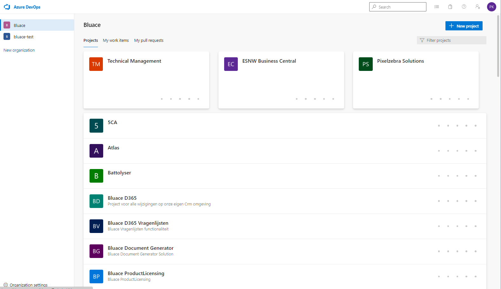
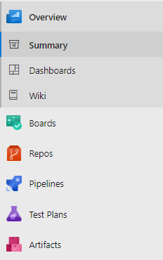
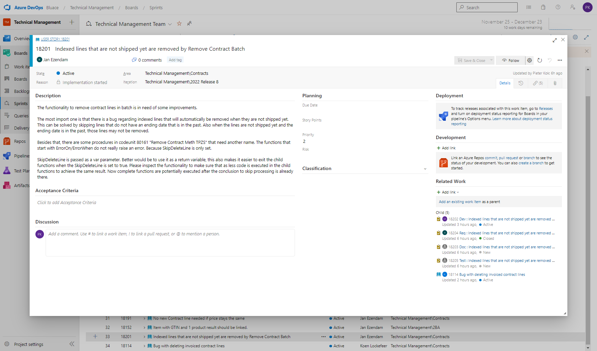
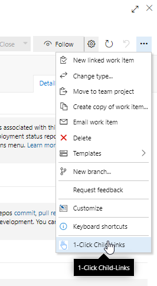

# Bluace development guidelines for Business Central

## Azure DevOps

At Bluace [Azure DevOps](https://dev.azure.com/bluace) is used as the primary tool for registering issues and bugs as user stories and administiring/assigning the associated tasks. Also the source code of our solutions and customer specific customizations is stored in Azure DevOps through Git. Build pipelines are used to generate the actual apps that can be imported into the customer's Business Central environments.

### Projects

After logging in to our DevOps environment, a list with assigned projects is shown. A project contains issues, code and automation used for a product (or products) or customization for a customer. Not all users have all projects in their list, a user is only assigned to a project when activities on that project are planned. 

When opening a project, the menu on the left hand side will enable you to do your work. 

The following menu options are used.
* Boards: contains all issue and task related functionality
* Repos: contains all code related functionality
* Pipelines: contains the automation that enable us to build our solutions and check them based on the NextMinor and NextMajor release of the Business Central application.

### Boards

All functionality in the Boards menu is about Work Items. A Work Item is a generic entity in DevOps that has many implementations (f.i. feature, bug, issue, user story and task). We decided to only use the Work Item types User Story and Task at Bluace.

Work Items can be part of a Sprint. A Sprint is an iteration of the software that can be planned, it can be translated as a release, and therefore contains of a starting and ending date.

#### User Stories

A User Story is a scenario of a functionality that must be created or the description of a problem in the application that must be fixed. It must also include a test scenario to test the requested working of the functionality. 

The person assigned to a User Story is the owner of the User Story. This is the person that is responsible for the Description and who can be contacted in case extra information is necessary for further processing the User Story. This person is in general also responsible for testing the realized modifications.

A User Story has one of the following statuses:
* New: The issue is only recorded, even the requirement that is available in the field Description is not final.
* Active: Someone worked on the User Story. Based on the related Tasks and the Discussion, the detailed status can be determined.
* Resolved: A modification has been created based on the User Story which is approved by the owner of the User Story.
* Closed: The user story contains a modification which is already part of a released Sprint.
* Removed: The User Story is created, contains some kind of modification that for some reason must not be processed any further. The field Discussion contains the reason why.

Besides this Status, the User Story can be categorized by using an Area. In case of our products, several areas are set up that match the functionalities the product consists of. The iteration determines if (and when) the User Story is planned. 

Because the original request is stored in the field Description, we cannot use the same field for f.i. feedback and status updates. That information must be stored by using the Discussion field. The combination of the information from the fields Description and Discussion must describe the current status of the issue in detail. 

Other Work Items can be linked to a User Story. This can be Tasks and other related User Stories. When using a # followed by a work item number in a text (f.i. in Discussion), other user stories can be linked. The number and description will then be part of the text.

To be able to record a more detailed status for User Stories, the default Tasks that we use can be created on the User Story by using the following function:

#### Tasks
<!-- TODO: Task is breakdown of a User Story -->

We always create 4 tasks by default:
* Req (Requirements)
* Dev (Development)
* Test (Test)
* Doc (Documentation)

Writing hours on specific task number level

<!-- TODO: Statuses -->
* Assigned tasks
* Active tasks
* Closed tasks

#### Closing tasks

#### Rework task (dev/test)
<!-- TODO: How to create and handle -->

#### Using sprints
For products, there are monthly sprints. Assign them on the user stories and tasks
Also use the current sprint for customer projects.

### Repos

#### Code

#### Branches

<!-- How to switch repositories in DevOps -->
<!-- Branch naming -->

#### Pull Requests

<!-- TODO: Assign an approver -->
<!-- TODO: Create for development -->
<!-- TODO: Manually assign the test task to the user story owner -->

### Pipelines

<!-- TODO: Which branch -->
<!-- TODO: How to create a new pipeline -->

### Use PowerBI dashboard

https://app.powerbi.com/groups/217f9ca3-59b9-4478-af67-ab20238547cf/reports/3e90ecfd-7903-4537-852a-2917994df28b/ReportSection

[:arrow_left:](../README.md) [Back](../README.md)