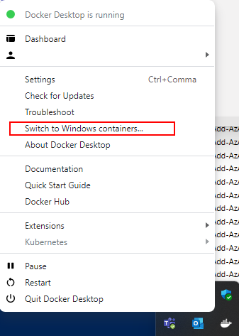
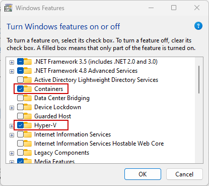

# Bluace development guidelines for Business Central

## General

### Required tools

At Bluace we develop AL code in a decentralized way. This means that each developer creates/modifies AL apps based on a docker system on the local laptop/system and check the code modification in into our source code manamement system, Git.

The Business Central development docker containers are created by BC Container Helper, a powershell module that is released by Microsoft to assist us with automating recurring development tasks. We use a development container as short as possible, to avoid that we miss changes that are done by Microsoft in the base applications.

This way of working leads to the following tools that must be installed on a developer system:

* [Git](https://git-scm.com/)
* [BC Container Helper](https://www.powershellgallery.com/packages/BcContainerHelper/)
* [Docker Desktop](https://www.docker.com/)
* [Visual Studio Code](https://www.vscode.com/)

Please note that Docker Desktop must be setup to use Windows Containers to be able to use it for Business Central development. This can be done by right clicking the docker icon in the taskbar and choosing to switch to Windows containers.

To be able use Docker in this way, the following Windows features must be installed:

### Required Visual Studio Code extensions

To be able to work with the AL language, the AL Language extension by Microsoft must be installed into Visual Studio Code. 

All other mentioned extensions help you with complying to this guideline. The waldo's CRS AL Language Extension helps with suffixing in control- and objects names and renaming to the correct file name structure. The XLIFF Sync tool is necessary to keep the language files in sync with the elements that are part of the application. Finally AZ AL Dev Tools/Al Code Outline makes AL development more simple in general by adding a wizard to create objects, add procedures based on calls to non-existing procedures, etc.

* [AL Language](https://marketplace.visualstudio.com/items?itemName=ms-dynamics-smb.al)
* [waldo's CRS AL Language Extension](https://marketplace.visualstudio.com/items?itemName=waldo.crs-al-language-extension)
* [XLIFF Sync](https://marketplace.visualstudio.com/items?itemName=rvanbekkum.xliff-sync)
* [AZ AL Dev Tools/AL Code Outline](https://marketplace.visualstudio.com/items?itemName=andrzejzwierzchowski.al-code-outline)

### Recommended Visual Studio Code extensions

All mentioned required Visual Studio Code extensions, and more, are part of the AL Extension Pack that waldo created. This pack also includes tools to f.i. create GUIDs, call REST clients, handle TODOs.

* [AL Extension Pack](https://marketplace.visualstudio.com/items?itemName=waldo.al-extension-pack)

### Recommended tools

It happens that multiple developers are working in the same Git repositories. This means that we sometimes will need to handle conflicts before we can ask for approval on a pull request. This can happen if another developer changed the same file in a way that Git cannot determine what to do during the merge. For those situations, Git Extensions can help. This tool is a user interface for Git, which makes life easier by not having to use the command line for the more advanced Git operations.

* [Git Extensions](https://gitextensions.github.io/)

When there is a need to consume a web service of some sort, Postman is an extermely valueable tool. It makes it possible to call a web service by manually inserting the web service address, headers and content to test a supplied web service. When this is working, there is a starting point for creating code in Business Central to do the same thing.

* [Postman](https://www.postman.com/)

[:arrow_left:](../README.md) [Back](../README.md)